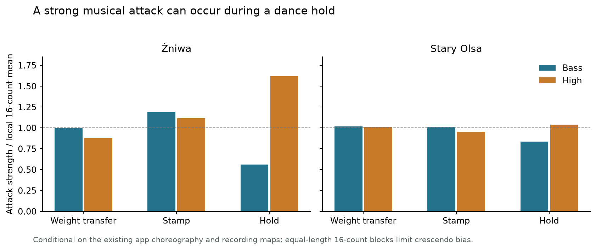
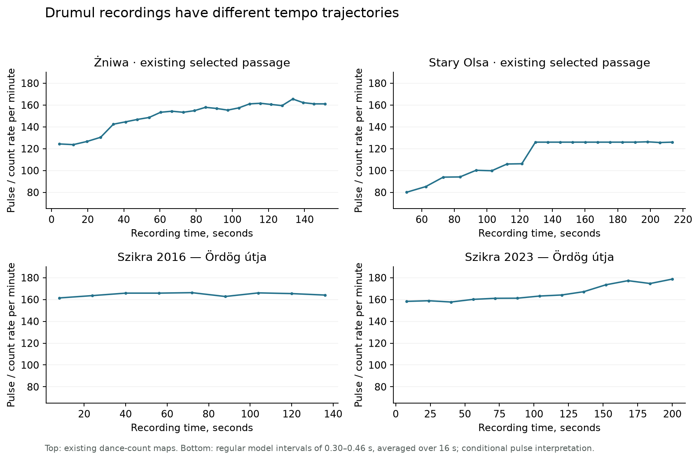
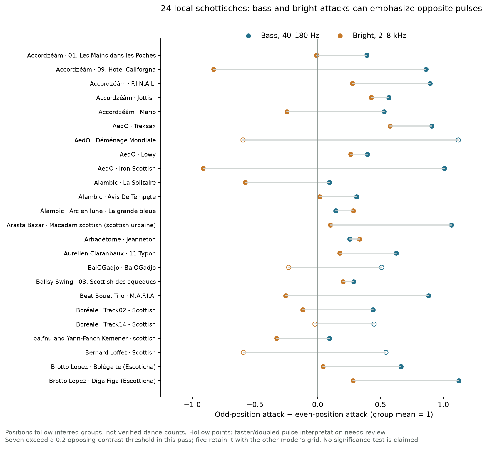
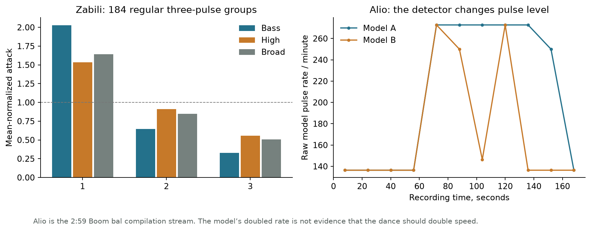
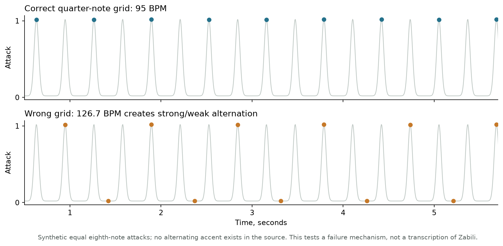

# Music, accents, and useful movement cues

Research snapshot: 22 September 2026. The application and its choreography were not changed.

Follow-up, 24 September: [movement review](../../docs/movement-review.md) applies these findings to the renderer. The [music and movement comparison](motion-review.html) uses the actual app animation and requires `pnpm dev`; the measurement viewer below remains standalone. The original renderer audit in this snapshot describes the pre-change implementation.

**The strongest sound is not a reliable instruction to draw a stronger foot impact.** The clearest counterexample is Żniwa’s Drumul: several of the strongest bright attacks occur on the dance’s holds. For schottische, bass and bright attacks sometimes emphasize opposite pulses, and the relationship can change within a recording.

The useful next experiment is **explicit stamps only for Drumul**, with ordinary support changes carried by the body’s movement. For schottische, retain the short–short–long stepping rhythm and continuous turn; the analysis does not justify a universal strong/weak flashing pattern.

- [Interactive recording review](review.html): attack envelopes, two beat predictions, section changes, and optional playback of your own matching local file. Open this HTML file in a browser; it works without a server or network connection.
- [Every analysed item, CSV](tracks.csv), including uncertain labels and raw model results.
- [Methods and checks](methods.md), [tested hypotheses](hypotheses.md), [coverage data](data/coverage.json), and [public recording sources](data/public-sources.json).

## What was actually covered

The earlier pass was **27 recordings sampled in short excerpts**. This pass decodes and measures complete files:

| Material | Coverage |
|---|---:|
| `Muzyka balfolk` | All 367 audio files; 340 distinct encoded audio streams |
| Second Music library | Metadata/hash audit of 1,705 files; 326 duplicates of the balfolk folder; 48 otherwise unidentified files additionally screened, representing 47 streams |
| Public full recordings | 8: four Drumul versions, Zabili, the Boom bal version of Alio, and two Tzadik releases |
| Public previews | 33, normally 20–30 seconds; these remain explicitly labelled as previews |
| Total computational coverage | **428 audio items, approximately 29.51 decoded hours** |

Every item received full-duration spectral analysis and two neural beat/downbeat passes. Harmonic/percussive texture analysis covered the dance-labelled candidates and controls. This is computational analysis, **not a claim of having listened through 29½ hours or verified every dance count by ear**.

Coverage means all decodable audio, not a guarantee that each local file contains a complete performance. The Brotto–Lopez three-time bourrée suite has an MP3 decoder error and only 50 seconds of decoded audio despite an estimated 90-second duration. It is flagged as damaged/partial. `Polska.mp3` decodes to 190 seconds; its bitrate-based metadata overestimates the duration by 14 seconds. Exported durations use decoded samples.

The second library’s remaining named repertoire was screened through metadata, not all decoded as potential balfolk. Unidentified recordings were not assigned dances merely because a detector found a pulse. Ten further likely duplicates across different encodings were found acoustically; they remain in the audit but are excluded from independent examples. Two recover labels for otherwise anonymous Skolvan tracks: *Trip to Skye* and *Joauste Ar C’heiste*. No original files or tags were modified.

Dance labels also needed review. `Escoticha` adds **Brotto–Lopez — Bolèga te**, missed by the earlier schottische search. *La fille du bourreau (Loudéac)* is not a bourrée; three-time bourrées, odd schottisches, and 5/8/11-count waltzes are not evidence for the ordinary versions animated here. Some database entries list several compatible dances, rather than one definitive classification.

## Drumul: what carries information

The full recordings were [Żniwa](https://zniwaband.bandcamp.com/album/dwa-ywio-y), [Stary Olsa](https://staryolsa.bandcamp.com/track/drumul-draculi-2), and two [Szikra / Tisza Ensemble recordings](https://tiszaensemble.org/szikra.html), from 2016 and 2023. A Jam.PT database preview supplies a fifth, limited comparison. The 2023 Szikra audio URL was present in the page’s commented-out wedding section; it was not a visible player entry.

The existing app has 44 weight transfers, 14 explicit stamps, and six held counts in a 64-count cycle. Stamps can repeat with the **same free foot**, without a support change. That is information body travel alone cannot show. The [step notes used by the app](https://duramecho.com/Dance/BEECIIFolkDance/Drumul_Dracului.html) distinguish those actions.

Using the existing recording maps, musical attacks were measured around each dance count and normalized within 16-count blocks. The public audio agrees closely with those maps: 100% of Żniwa’s and 96% of Stary Olsa’s neural predictions inside the selected passages fall within 60 ms of a mapped count. This checks temporal correspondence; it does not independently prove the choreography’s figure phase.

| Recording / attack band | Weight transfer | Stamp | Hold |
|---|---:|---:|---:|
| Żniwa, bass | 1.00 | 1.19 | **0.56** |
| Żniwa, bright | 0.88 | 1.11 | **1.62** |
| Stary Olsa, bass | 1.02 | 1.01 | 0.84 |
| Stary Olsa, bright | 1.01 | 0.96 | 1.04 |

Values are attack strength relative to the local block mean, not loudness or foot force. In Żniwa, a held count is the strongest bright attack in **11 of 24** analysed 16-count blocks. Driving foot impacts from that signal would invent movement during a hold. Stary Olsa does not show the same strong relationship between stamps and bass.

Acceleration also belongs to the recording:

- **Żniwa:** the selected dance passage accelerates from roughly 120 toward 165 counts/minute. A neural detector switches to half-time in the later section; that apparent slowdown is not the music slowing down.
- **Stary Olsa:** the selected passage progresses through approximately 80, 94, 100, 106, and 126; later material reaches roughly 150. The opening and first transition are less certain.
- **Szikra 2016:** generally around 161–166 on the tested pulse interpretation, without the large progressive acceleration seen in the other arrangements’ timing data.
- **Szikra 2023:** roughly 158 early and 175–179 late. More gradual than the Stary Olsa transitions.

**Animation implication:** keep the stamp/hold sequence explicit. Fourteen small stamp cues per dancer per cycle would replace 58 current contact flashes—a **76% reduction**—while retaining the repeated non-weight-bearing actions. Keep holds visually held even when the arrangement adds a bright accent. Increasing tempo and increasing impact size should be separate decisions.

## Schottische: several different accent behaviours

Coverage includes **24 ordinary locally labelled schottisches**, five local mixed/irregular variants, and six public previews. Complete local recordings were measured, including introductions, changes of texture, and endings.

The two models’ beat agreement for the 24 ordinary tracks has a median of 94%; accepted regular groups cover a median of 91% of their duration. These are agreement and coverage figures, not accuracy against human annotations. Four tracks receive a faster/doubled pulse interpretation that still needs a dancer’s check.

| Behaviour found | Examples | Consequence for a shared animation |
|---|---|---|
| Bass and bright attacks oppose one another | Accordzéâm — *Hotel Califorgna*; AedO — *Iron Scottish* | “The strong beat” depends on which layer is measured |
| Both layers favour the same alternating positions | Accordzéâm — *Jottish*; AedO — *Treksax*; Brotto–Lopez — *Diga Figa* | A pattern plausible here would disagree with the previous group |
| One position is especially quiet within a four-pulse group | Alambic — *La Solitaire* | Simple strong/weak alternation misses the actual asymmetry |
| Bass alternation is modest | Alambic — *Arc en lune / La grande bleue*; Arbadétorne — *Jeanneton* | Enlarging alternate impacts would add emphasis the measurement barely supports |
| Accent relationship changes later in the track | Accordzéâm — *F.I.N.A.L.* | One song-wide average conceals section differences |

For example, *Hotel Califorgna* has mean-normalized bass strengths **2.05, 0.53, 0.81, 0.60**, while bright attacks give **0.73, 1.37, 0.44, 1.46**. *Jottish* instead gives bass **1.32, 0.65, 1.25, 0.78** and bright **1.32, 0.74, 1.10, 0.83**. Position numbers are relative to the model’s inferred group, not automatically the app’s dance counts.

The main pass finds opposing bass/bright contrasts above a descriptive 0.2 threshold in **7 of 24** tracks. Five retain that result with the other model’s grid; four retain it across both models, both linear/log measures, and all three sampling tolerances. *Mario* and *M.A.F.I.A.* are less stable cases. This distinction matters more than presenting seven as a definitive genre statistic.

Separating sustained and transient texture supports the clearest examples. In *Hotel Califorgna*, transient broadband attacks favour positions 2/4 while sustained-component attacks favour 1/3. In *Jottish*, both favour 1/3. These are signal components, not cleanly isolated instruments.

There is useful **within-song variance**, too. In *F.I.N.A.L.*, bright attacks favour one parity through much of the recording, reverse in accepted blocks starting around **232–257 s**, then turn back around 268 s. The viewer exposes those passages. It remains possible for a change in inferred group phase to contribute to such a reversal, so this is an inspection target rather than a definitive arrangement transcription.

The subdivision test does **not** support adding universal dotted/swing timing. In the 20 ordinary local examples whose selected pulse was below 140/minute, the dominant bright offbeat peak was between **0.46 and 0.53** of the interval, close to halfway. This cannot resolve fine dancer timing, especially with different detector and spectral latencies.

**Animation implication:** make the short–short–long support pattern and the transition into the turn legible. Let movement duration and direction do most of the work. A common left/right strength pattern, fixed backbeat flash, or automatic swing would overfit particular recordings.

## Zabili and Alio: correction and version differences

**The earlier Zabili interpretation needs correction.** The approximately 126 BPM grid and its alternating-accent conclusion were not reliable. Both full-track models instead support a roughly **95 BPM** pulse and predominantly three-pulse groups. Their beat agreement is 96%. Across 184 accepted three-pulse groups, the bass profile is **2.03, 0.65, 0.33**; bright attacks are **1.54, 0.91, 0.56**. The first inferred position is strongest in this recording. That does not establish a universal mazurka step-force pattern. Source: [ba.fnu — Zabili](https://bafnu.bandcamp.com/track/zabili-mazurka).

**The full Alio analysed here is the 2:59 Boom bal compilation stream**, [credited to Naragonia and Pascale Rubens](https://homerecordsbe.bandcamp.com/track/alio). It is not automatically interchangeable with [Tandem](https://www.naragonia.com/shop/products/cd-tandem?variant=41847353671746). In the compilation recording, the opening pulse is around 136/minute, but one model starts tracking subdivisions around 54–64 s and reports roughly 273. Averaging that output produces a misleading “250 BPM”.

Three additional database previews check the version issue: **Tandem ~125**, **Naragonia live 2020 ~125**, and **Duo L-Hêtre Heureux with David Häggi ~111**. These are short excerpt estimates, not full-track tempo maps. The earlier reference to a 5:30 Alio must not be treated as the duration of the original Naragonia album track: the [found 5:30 listing](https://repositorio.ipcb.pt/bitstream/10400.11/6260/1/Miguel%20Menezes%2818%29%20r.pdf) was an ensemble-repertoire listing, not official album metadata.

Other complete local mazurkas supply counterexamples to applying Zabili’s profile everywhere. **ARVEST — Erfin** has bass strongest at inferred position 1 but bright attacks strongest at 3. **Brotto–Lopez — La Candèla** has bass **2.11, 0.33, 0.56**, while bright attacks are **0.79, 1.11, 1.10**. **Arasta Bazar — Adieu L’ami** instead has similar bass emphasis at positions 1 and 3, with a much quieter 2. These comparisons use dozens or hundreds of accepted groups, rather than only the Alio previews.

I also tested the failure mechanism directly. Equal synthetic eighth-note attacks at a 95 BPM quarter-note rate acquire a convincing alternating strong/weak pattern when sampled on a 126.7 BPM grid. No alternating accent exists in that synthetic source. A neat pattern is insufficient evidence that the underlying beat grid is correct.

## Which cues are worth keeping for the other animations?

These are design judgments informed by the measured music and the existing choreography, not changes made to the app.

| Dance | Most useful information to preserve | Where repeated thuds become noise |
|---|---|---|
| Bourrée bancale | Three transfers and the sustained third contact, plus crossing/meeting directions | Every quick transfer across six dancers competes with the formation; “six” describes dancers, not six-time music |
| Chapelloise | Turn, side exchange, underarm passage, partner change | Uniform flashes during the walking passages add little; jig attacks are not one-for-one steps |
| Cercle circassien | Which dancers move, meeting the next partner, swing versus promenade | Flashing every beat distracts from the invitations; continuous swing support is not a sequence of equal impacts |
| Noirmoutier | Unequal forward/back step rhythm and the alternating fronts | Identical flashes obscure the long returns and pivots; evidence is limited to one local full recording and three previews |
| Waltz | Continuous turn and the longer movement shape across three counts | A percussive three-flash pattern makes a flowing movement look stamped |
| Mazurka | Suspension/lowering, delayed transfer, then travel | A musical attack during suspension should not manufacture another footfall |
| Hanter-dro | `1 & 2 · 3`, close connection, distinction between travelling and closing | Music labels and detected subdivisions do not resolve the app’s existing Barray count-rate uncertainty |
| An dro | `1 & 2 · 3 & 4`, lateral travel versus in-place return, arm motion | Six flashes every four counts across a chain easily dominate its movement |
| Tzadik Katamar | Walk versus sway, crossing versus turning | A sway can transfer support without being a stamped step; two recordings are not broad evidence of repertoire variation |

Local examples beyond the focus dances include *Allez, bourrés / Experior* (two-time bourrée), *Jopelloise / La Scoumoune* (chapelloise), *Starwars / Quadratures* (cercle), *Les gens qui sont riches* (Noirmoutier), *Lora Luna / Trip to Skye* (waltz), *Kuzhet / ba.fnu’s Hanter dro*, and *Café Coiffeur / Ma flanedenn* (An dro). Their complete measurements and uncertainties are in the CSV and viewer. These are collection examples, **not a measured popularity ranking**.

## A timing issue independent of song choice

The current renderer detects a contact when an eased weight value crosses ±0.35. It does not use an explicit contact timestamp. At the default practice tempos, that puts the flash approximately:

| Action | Delay after its programmed contact onset |
|---|---:|
| Schottische transfer | 85 ms |
| Waltz transfer | 82 ms |
| Mazurka transfer | 248 ms |
| Drumul transfer | 65 ms |
| Drumul explicit stamp | 9 ms |

Frame scheduling adds quantization. This is not proof that the body’s motion is wrong; it shows that the flash is inconsistently timed as an impact cue. Changing musical accent weights before settling what the dot represents would conflate two separate issues.

With five couples, schottische produces ten simultaneous dots at each of ten contact moments per five-second cycle. That is **two bursts per second**, each repeated across ten figures—not twenty separately timed musical events. The same opacity and 200 ms dance-clock fade are used for ordinary transfers and explicit stamps.

My preferred next experiment is therefore small: **keep the existing movement; use a transient dot for an intentional stamp; use a quiet support cue, if needed, for weight-bearing state.** Compare that with no foot cue for the couple dances. Do not encode “strong music” as a heavier step until the recording’s pulse level, phrase origin, and intended dance action are independently settled.
